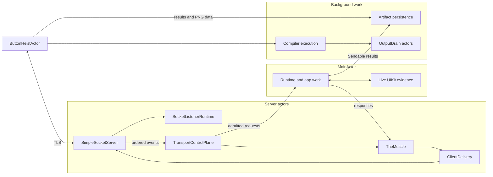

# Actor Isolation

Actors own mutable state. An `await` permits other work to change that state;
an earlier check is a snapshot, not permission to commit after suspension.

**Illustrates:** [ARCHITECTURE.md](../ARCHITECTURE.md)
**Source of truth:** `ButtonHeistActor.swift`, `TransportControlPlane.swift`,
`TheMuscle.swift`, `ClientDelivery.swift`, `SimpleSocketServer.swift`,
`SocketListenerRuntime.swift`, `HeistCompilerProcess.swift`, and
`HeistResultRecording.swift`.

The runtime, Getaway, Brains, Vault, observation stream, Tripwire, and input
dispatch share `MainActor`. UIKit references stay there. Observation leases
release their demand through an isolated destructor, including when another
executor releases the final reference.

The client actor owns connection, discovery, and command coordination.
Reachability probes retain advertisement sequences. Completion must still
belong to a ready session and an uncancelled task; it can remove only the
advertisement it sampled.

The socket server checks its listener generation after the final readiness
await and writes the port in the same actor turn. The Muscle projects the
complete `StatusSession` in one actor read.

Result recording and screenshot persistence use explicit `@concurrent`
execution with immutable inputs. Their callers await completion and retain
the same recording policy, codec, and error handling. Explicit screenshot
paths use atomic replacement so concurrent writes cannot mix bytes.

Compiler execution is a stateless, `Sendable` runner with an explicit
`@concurrent` entry point. Each invocation owns its process cleanup. Each
`OutputDrain` actor owns one pipe's capture buffer and stop state.
