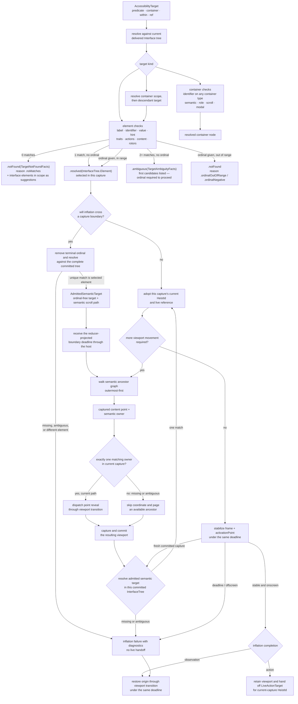
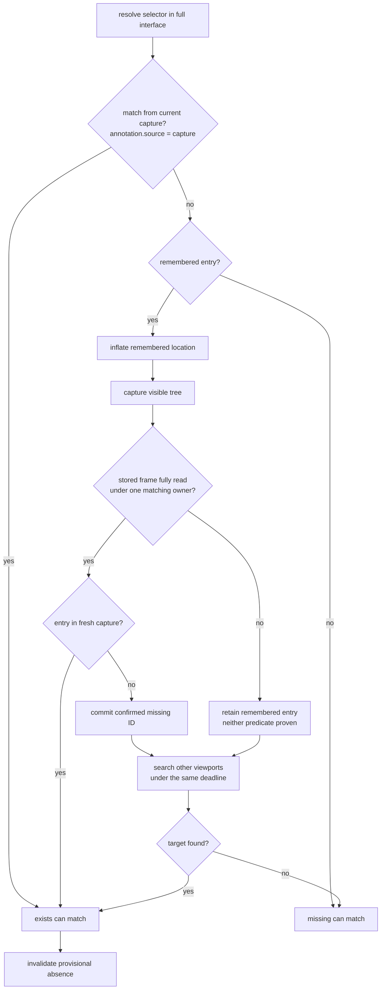

# Element Inflation

How an `AccessibilityTarget` resolves in the delivered tree and, for actions,
becomes a live actionable element. The same resolver also serves predicates and
`get_interface` subtree queries.

**Illustrates:** [ARCHITECTURE.md](../ARCHITECTURE.md), [API.md](../API.md), [HEIST-LANGUAGE-SPEC.md](../HEIST-LANGUAGE-SPEC.md), [SCOPE-AND-LIMITS.md](../SCOPE-AND-LIMITS.md)
**Source of truth:** `ButtonHeist/Sources/ThePlans/Model/AccessibilityTarget.swift`, `ButtonHeist/Sources/ThePlans/Model/ElementPredicate.swift`, `ButtonHeist/Sources/TheInsideJob/TheVault/TheVault+TargetResolution.swift`, `ButtonHeist/Sources/TheInsideJob/TheBrains/ElementInflation.swift`, `ButtonHeist/Sources/TheInsideJob/TheBrains/ElementInflation+SemanticReveal.swift`, `ButtonHeist/Sources/TheInsideJob/TheBrains/ElementInflation+Geometry.swift`

Element presence uses the same capture and commit pipeline:

Notes:

- Resolution reads the **interface tree only** (`TheVault.interfaceTree`). Live capture proves current actionability and geometry for an interface element; it is not a second search space.
- Container-only targets are valid for predicates and subtree queries. Element-
  only actions reject a resolved container with a typed target-kind error.
- `ElementInflation` owns its reveal transaction through completion. Actions
  retain the revealed viewport on success and attempt restoration on failure.
  Element inflation for observation attempts restoration after either outcome and
  returns the typed restoration outcome. Wait orchestration adds no outer
  viewport transaction. Container inflation and exhaustive wait search
  orchestration remain follow-up work.
- Element presence requires a match in the current parser capture. Geometry
  can be unavailable. The element annotation's `source` records capture or
  memory and survives subtree projection and encoding. Remembered
  offscreen entries guide wait inflation and block absence until fresh evidence
  disproves their stored positions. The capture boundary admits confirmed
  missing IDs only after viewport movement, under one matching semantic scroll
  owner, with complete frame coverage and valid stored geometry. The canonical
  commit removes those IDs and preserves other discovery memory.
  A miss continues into search under the same deadline. A later sighting
  invalidates current absence in the shared expectation evaluator.
- Matching is **exact or miss**: string checks are case-insensitive with typography folding (smart quotes, dashes, ellipsis fold to ASCII), traits compare as sets. On a miss the resolver returns structured facts — the interface elements in scope — through the diagnostic path; substring matching is not part of resolution.
- A capture-local action can join the selected element's current `HeistId`
  directly to live UIKit evidence. Before any cross-capture reveal, inflation
  admits an `AdmittedSemanticTarget` only when the selected target without its
  terminal ordinal uniquely resolves to that same element in the complete
  committed interface.
- `AdmittedSemanticTarget` is the sole identity retained across committed
  captures. After every viewport transition or other fresh committed capture,
  inflation re-resolves it and adopts only the matching element's current
  `HeistId` and live reference for geometry and dispatch. Missing or ambiguous
  resolution fails; a stale id or newly visible sibling cannot take over.
- `HeistExecution` owns the leaf and whole-heist deadlines. The host passes the
  earlier boundary target through dispatch, inflation, nested reveal, refresh,
  navigation, and geometry stabilization. Nested reveal follows the semantic ancestor graph
  outermost-first and never derives a second budget from that graph.
- A known semantic target that later gains scroll membership earns at most one
  direct reveal attempt. Its captured content point and producing scroll
  container are one evidence value. The runtime must find exactly one matching
  live owner immediately before point dispatch. The owner's path may change. A
  missing or ambiguous owner cannot donate its coordinate to an ancestor or
  sibling and instead selects the established ancestor paging route. Point
  reveal and paging both use the canonical viewport transition, observation,
  Vault commit, and target re-resolution pipelines. Content absent from admitted
  semantic truth cannot be revealed, and exploration never scans for an old
  `HeistId` as identity.
- The ordinal is a capture-local disambiguator over a semantic base selector,
  never durable identity. A target that becomes unique only through its terminal
  ordinal cannot be admitted across a capture boundary.
