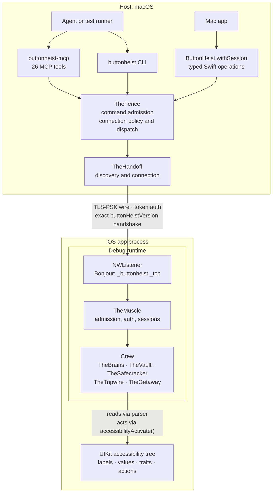

# System Topology

Mac apps, agents, and test runners drive the iOS app through one client transport. The iOS runtime supports source linkage, prebuilt linkage, and launch-time injection.

**Illustrates:** [ARCHITECTURE.md](../ARCHITECTURE.md)
**Source of truth:** `ButtonHeist/Sources/TheScore/Wire/Messages.swift`, `ButtonHeist/Sources/TheScore/Core/TLSPreSharedKeyMaterial.swift`, `ButtonHeist/Sources/TheInsideJob/TheInsideJob.swift`, `ButtonHeist/Sources/TheInsideJob/Server/NetworkBoundary/SocketListenerStartup.swift`, `ButtonHeist/Sources/TheInsideJob/Server/NetworkBoundary/BonjourAdvertisement.swift`, `ButtonHeistCLI/Package.swift`, `ButtonHeistMCP/Package.swift`

Notes:

- The wire is TLS with a pre-shared key derived from the session token (`ButtonHeistTLSPreSharedKey.makeNetworkParameters(token:)`, HKDF-SHA256, cipher `TLS_PSK_WITH_AES_128_GCM_SHA256`). Token auth then happens again at the message layer (`authenticate`).
- The version handshake compares the client's and server's typed `ButtonHeistVersion` values for exact equality and rejects on any mismatch (`MuscleHandshakePhase`).
- Source Release builds exclude the runtime through `#if DEBUG`. App builds that use the prebuilt Debug runtime must exclude its framework from distribution.
- `ButtonHeist.withSession` scopes the existing Fence connection. Typed Swift calls and command adapters share plan execution, recording, and interface capture.
- CLI and MCP admit commands before Fence applies connection policy. Local commands do not enter TheHandoff. Both session adapters suspend idle expiry during active requests.
- Current-view capture refreshes live evidence without viewport exploration. Discovery remains an explicit query choice for Swift callers.
