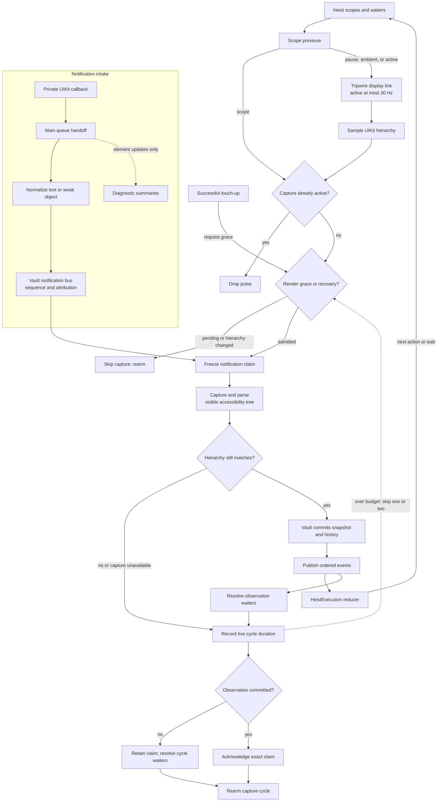

# Tripwire and Observation Admission

Tripwire paces live observation and samples UIKit state. The Vault captures the
visible accessibility tree and owns committed semantic truth. UIKit capture,
notification attribution, and commit run on the main actor.

**Source of truth:** `TheTripwire+Pulse.swift`, `TheTripwire+PulseAdmission.swift`,
`AccessibilityNotificationObserver.swift`, `AccessibilityNotificationBus.swift`,
`SemanticObservationCycle.swift`, `SemanticObservationStream.swift`, and
`TheVault+State.swift` under `ButtonHeist/Sources/TheInsideJob/`.

The capture cycle drops pulses while a task is active. Rendering grace skips
one capture opportunity after touch-up or a hierarchy change. A cycle longer
than one display frame skips one later opportunity. A cycle longer than two
frames skips two opportunities. These causes share one admission policy. Repeated render requests
cannot extend an active delay.

Skipped opportunities leave notifications and capture waiters pending. Failed
captures retain their exact notification claim for retry. A successful commit
publishes its events before the cycle acknowledges that claim. Injected test
pulses bypass live pacing and do not read the measurement clock.

## Boundaries to Preserve

| Boundary | Why it exists |
|----------|---------------|
| Display pulse and cycle identity | A pulse samples UIKit. Cycle identity rejects stale task completion. |
| Notification bus and semantic history | The bus retains incoming facts. History retains committed interpretations. |
| Hierarchy signal and semantic snapshot | UIKit identity detects possible change. The visible tree establishes semantic change. |
| Screenshot windows and accessibility roots | Images include visual backgrounds. Accessibility parsing follows modal scope. |
| Observation pacing and business deadlines | Pacing schedules reads. Deadlines limit execution time. |

## Areas for Further Investigation

1. **Visible capture cost.** Measure parsing, normalization, comparison, and
   publication separately. Pacing reduces frequency but does not reduce the
   cost of each accepted visible-tree capture.
2. **Queued notification attribution.** The main queue assigns ownership when
   it delivers a callback. A callback can enter before one Vault detaches and
   arrive after another Vault attaches. Define ownership at entry or delivery.
   Then test runtime replacement and action-window closure through the shared adapter.
3. **Capture freshness.** A pulse samples hierarchy before its task executes.
   Post-capture validation rejects a changed hierarchy, but the rejected parse
   has already consumed main-thread time. Measure whether this retry path is
   common before adding another live read.
4. **Semantic stillness and visible motion.** Equal observations establish
   accessibility stability. They do not establish that all rendered animation
   has ended. Keep this distinction explicit in settling and recording tools.

See [the observation pipeline](observation-pipeline.md) for execution, result,
and rendering boundaries.
